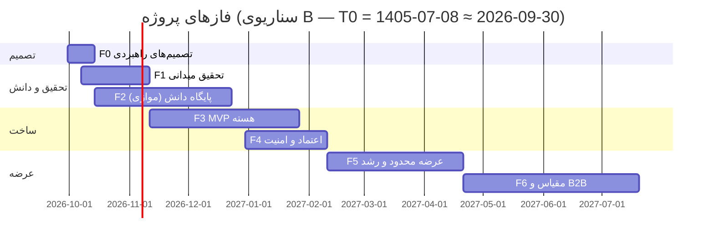

# ROADMAP — نقشهٔ راه فازبندی‌شدهٔ اجرا

> **پروژه:** دستیار حقوقی و اداری پرستار (وب‌اپلیکیشن + هوش مصنوعی)
> **تاریخ تنظیم:** ۱۴۰۵/۰۷/۰۸ · **مبدأ زمان (T0):** همان ۱۴۰۵/۰۷/۰۸ = هفتهٔ ۱
> **مبدأ مرجع محتوا:** فایل‌های `T01…T12` در پوشهٔ `دسته‌بندی موضوعی` (خواندنشان از `دسته‌بندی موضوعی\INDEX.md`)

⚠️ **دو قاعدهٔ سراسری این نقشهٔ راه:**
1. **همهٔ اعداد کمّی (درصد، تومان، تعداد) «آستانهٔ پیشنهادی» هستند** و تا فازی که دادهٔ واقعی تولید شود، اعتبارسنجی‌نشده‌اند (مطابق قاعدهٔ «اعداد نمونه‌ای» در INDEX).
2. **هیچ فازی بدون عبور از «گیت خروج» فاز قبلی شروع نمی‌شود** — گیت‌ها در `گیت‌ها-شاخص‌ها-ریسک‌ها.md` تعریف شده‌اند و قابل مذاکره نیستند، مگر با تصمیم مکتوب در دفتر تصمیم (بخش ۱۰ همین فایل).

---

## ۱. نمای کلی فازها

| فاز | نام | سؤالی که فاز جواب می‌دهد | هفته (سناریوی B) | گیت خروج | فایل |
|---|---|---|---|---|---|
| **F0** | تصمیم‌های راهبردی و قالب‌بندی | دقیقاً چه چیزی را، برای کدام برش، با کدام داده و کدام لحن می‌سازیم؟ | H1–H2 (~مهر ۱۴۰۵) | **G0** | `F0-تصمیم‌های-راهبردی.md` |
| **F1** | تحقیق میدانی و اعتبارسنجی درد | آیا درد واقعی، فراوان و قابل‌پرداخت است؟ برش درست کدام است؟ | H2–H6 (~مهر–آبان) | **G1** | `F1-تحقیق-میدانی-و-اعتبارسنجی.md` |
| **F2** | پایگاه دانش حقوقی و Data Moat | آیا می‌توانیم دانشِ درست، به‌روز و قابل‌استناد بسازیم؟ | H3–H12 (موازی، ~مهر–آذر) | **G2** | `F2-پایگاه-دانش-حقوقی.md` |
| **F3** | ساخت MVP هسته | آیا flows اصلی در کمتر از ۳ دقیقه کار می‌کند؟ | H6–H16 (~آبان–دی) | **G3** | `F3-MVP-هسته.md` |
| **F4** | اعتماد، امنیت و کنترل کیفیت | آیا می‌توانیم بی‌ریسکِ حقوقی و امن عمومی‌اش کنیم؟ | H13–H18 (~آذر–بهمن) | **G4** | `F4-اعتماد-امنیت-کیفیت.md` |
| **F5** | عرضهٔ محدود، GTM و رشد | آیا کاربران واقعی استفاده، بازگشت و (شاید) پرداخت می‌کنند؟ | H17–H26 (~دی–اسفند) | **G5** | `F5-عرضه-محدود-و-رشد.md` |
| **F6** | مقیاس: B2B2C، درآمد و اپ نیتیو | چگونه مقیاس می‌دهیم بدون شکستن اعتماد؟ | H27+ (~فروردین ۱۴۰۶ به بعد) | **G6** | `F6-مقیاس-B2B-و-اپ-نیتیو.md` |

**جمع زمانی (سناریوی B، تیم ۴.۵ نفره):** ~**۱۸ هفته تا عرضهٔ عمومی محدود** (پایان F4) · ~**۲۶ هفته تا ثبات رشد** (پایان F5).

---

## ۲. پارامترهای ورودی و سناریوهای ظرفیت

| سناریو | ترکیب تیم | سرعت نسبی | عرضهٔ عمومی | ملاحظات |
|---|---|---|---|---|
| **A — انفرادی/نیمه‌وقت** | ۱ توسعه‌دهندهٔ همه‌کاره + مشاور حقوقی پاره‌وقت | ×0.4 | ≈ ۴۵–۵۵ هفته | فقط اگر F2 (پایگاه دانش) برون‌سپاری شود |
| **B — تیم حداقلی (پیشنهادی)** | PM 0.5 · Backend/AI 1 · Frontend 1 · Legal SME 1 · Design/QA/DevOps به‌صورت_share | ×1.0 | ≈ ۱۸ هفته | تعادل سرعت/هزینه |
| **C — تیم کامل** | B + QA 1 + Growth 0.5 | ×1.3 | ≈ ۱۴ هفته | هزینهٔ انسانی ≈ ۱.۸ برابر B |

> **پارامترهای باز که زمان‌بندی را جابه‌جا می‌کنند:** D3 (مجوز دادهٔ نظام پرستاری) و D1 (برش MVP). اگر D3 تا پایان H4 بسته نشود، F2 با «دادهٔ عمومیِ دست‌چین‌شده» ادامه می‌یابد و گیت G2 یک هفته عقب می‌افتد.

### تیم هدف (سناریوی B) — نقش‌ها

| نقش | FTE | فازهای اصلی | مسئولیت کلیدی | Trace |
|---|---:|---|---|---|
| Product Owner / PM | 0.5 | F0–F6 | تصمیم، اولویت، گیت‌ها، دفتر تصمیم | T12 |
| Legal SME (کارشناس حقوق عمومی/دانشجوی ارشد) | 1.0 | F1–F6 | پایگاه دانش، بازبینی پاسخ‌ها، DIKW کیفیت | T05, T08, T10 |
| Backend / AI Engineer | 1.0 | F2–F6 | RAG، متادیتا، OCR، API، امنیت سرور | T08, T09 |
| Frontend (Next.js/PWA) | 1.0 | F3–F6 | PWA، دسترس‌پذیری WCAG، حالت شیفت شب | T06, T08 |
| UI/UX Designer | 0.3 | F1, F3, F5 | Design System «Clinical Calm» | T06, T07 |
| QA / Security (پاره‌وقت) | 0.3 | F3–F6 | Eval harness، تست نفوذ، WCAG | T09, T10 |
| Community / Ops | 0.2 | F1, F5, F6 | مصاحبه، پشتیبانی، کانال‌های صنفی | T02, T11 |

---

## ۳. گانت اجرایی (سناریوی B)

```
هفته          1  2  3  4  5  6  7  8  9 10 11 12 13 14 15 16 17 18 19 20 21 22 23 24 25 26
F0 تصمیم      ██ ██
F1 تحقیق        ██ ██ ██ ██ ██
F2 دانش              ██ ██ ██ ██ ██ ██ ██ ██ ██ ██
F3 MVP                              ██ ██ ██ ██ ██ ██ ██ ██ ██ ██
F4 اعتماد                                        ██ ██ ██ ██ ██ ██
F5 عرضه                                                            ██ ██ ██ ██ ██ ██ ██ ██ ██ ██
              ▲G0     ▲G1              ▲G2              ▲G3   ▲G4(G5 در H26)
```



---

## ۴. خلاصهٔ گیت‌های خروج (شرح کامل در فایل گیت‌ها)

| گیت | زمان | شرط‌های الزامی (هر عدم‌تحقق = توقف فاز بعد) |
|---|---|---|
| **G0** | پایان H2 | ۸ تصمیم D1–D8 بسته/مستند؛ برش MVP روی یک مشکل قفل شد؛ مسیر دسترسی به دادهٔ حقوقی مشخص (حتی «منفی» هم تصمیم است) |
| **G1** | پایان H6 | ≥۳۰ مصاحبهٔ معتبر؛ ۵ درد رتبه‌بندی‌شده؛ ≥۲۰ سند واقعیِ بی‌نام؛ ≥۶۰٪ گفتند «اگر دقیق بود استفادهٔ مداوم می‌کنم»؛ پروتوتایپ کاغذی/کلیک‌ثرو با ۱۲ کاربر تست شد |
| **G2** | پایان H12 | ≥۳۰۰ مقرره با متادیتای کامل (Status/Effective/Expiration/OverriddenBy)؛ Golden Set ۱۵۰ سؤال؛ Retrieval Hit@5 ≥ ۸۵٪؛ صفر پاسخ مبتنی بر قانون منسوخ |
| **G3** | پایان H16 | Flow کامل «عکس فیش ← خطا ← نامه» < ۳ دقیقه؛ تأیید انسانی OCR اجباری؛ ۵۰ کاربر داخلی؛ بدون ادعای وکالت در هیچ خروجی |
| **G4** | پایان H18 | تأییدیهٔ کتبی وکیل/مشاور بر ToS و دیسکلایمر؛ گمنام‌سازی در تست عبور کرد؛ Hallucination در مرجع‌دهی = ۰؛ WCAG 2.2 AA روی ۵ صفحهٔ اصلی؛ تست نفوذ بدون آسیب‌پذیری بحرانی |
| **G5** | پایان H26 | Activation ≥ ۴۰٪؛ D7 ≥ ۲۰٪؛ ≥۵۰۰ سند پردازش‌شده؛ CSAT ≥ ۴.۲/۵؛ ≥۱ پایلوت B2B امضاشده؛ تصمیم قیمت‌گذاری داده‌محور |
| **G6** | H30+ (شرطی) | ۱۰–۲۰ هزار کاربر فعال ماهانه (آستانهٔ S1 برای اپ نیتیو) + حاشیۀ مثبت هر خدمت پولی + هزینهٔ هر پرسش زیر سقف مصوب D9 |

---

## ۵. ریتم اجرایی

| قاعده | شرح |
|---|---|
| اسپرینت | ۲ هفته‌ای؛ برنامۀ هر اسپرینت در پایان اسپرینت قبل قفل می‌شود |
| Scope freeze | از H8 به بعد، افزودن قابلیت جدید فقط با حذف یک قابلیت هم‌ارز (قانون «یکی بیاید، یکی برود») |
| Definition of Ready | هر کار WBS فقط با: معیار پذیرش کمّی + Trace به فایل T + مالک نامدار وارد اسپرینت می‌شود |
| Definition of Done | کد + تست + مستند + عبور از Eval Set + (برای UI) بازبینی WCAG + بازبینی Legal SME اگر خروجی متنی دارد |
| دمو | هر جمعه، دموی زنده روی محیط تست — بدون اسلاید |
| بازبینی گیت | در هفتهٔ گیت، جلسهٔ «عبور/عدم عبور» با تک‌تک شرط‌های عددی؛ خروجی: صورت‌جلسه + امضای PM و Legal Lead |
| گزارش ماهانه | پیشرفت فاز، مصرف بودجهٔ واقعی در برابر نمونهٔ برآوردی، ریسک‌های فعال، تغییرات دفتر تصمیم |

---

## ۶. ساختار شناسه‌ها و Trace

- **شناسهٔ کار:** `F<فاز>-W<شمارهٔ کار>` — مثال: `F3-W07` = هفتمین بستهٔ کاری فاز MVP.
- **شناسهٔ تصمیم:** `D<n>` (دفتر تصمیم، بخش ۱۰).
- **شناسهٔ گیت/شاخص:** `G<n>` و `K<n>`.
- **Trace:** هر کار باید به یکی از فایل‌های `T01…T12` ارجاع داشته باشد؛ کارِ بدون Trace رد می‌شود. این کار تضمین می‌کند هیچ قابلیتی خارج از اسناد منبع «اختراع» نشود.

---

## ۷. بودجهٔ برآوردی (⚠️ همه اعداد نمونه‌ای‌اند و باید در F0 واقعی شوند)

| سرفصل | مبنای محاسبه | ماهانه (تومان — نمونه) | فازهای پرمصرف |
|---|---:|---|---|
| نیروی انسانی (سناریوی B) | ۴.۵ FTE | ۳۵۰ – ۵۵۰ میلیون | F2، F3 |
| مدل زبانی (API/token) | هزینهٔ هر پرسش × حجم | ۱۵ – ۶۰ میلیون | F3 → F6 (سقف: `K-هزینه/پرسش`) |
| سرور و زیرساخت (میزبانی ایران/خارج + DB + جستجوی برداری) | محیط‌های Dev/Staging/Prod | ۱۰ – ۳۰ میلیون | F3 به بعد |
| OCR و پردازش تصویر | هر صفحه | ۵ – ۲۰ میلیون | F3، F5 |
| حقوقی (قرارداد، ToS، بیمهٔ مسئولیت، review) | موردی | ۲۰ – ۸۰ میلیون (یک‌باره + سالانه) | F0، F4 |
| تحقیق میدانی (حق‌الزحمهٔ مصاحبه) | ۳۰ × مبلغ | ۳۰ – ۶۰ میلیون (یک‌باره) | F1 |
| طراحی و برندینگ | Design System + هویت بصری | ۴۰ – ۹۰ میلیون (یک‌باره) | F0، F3 |
| بازاریابی و رشد | محتوای آموزشی + کانال‌های صنفی | ۳۰ – ۱۰۰ میلیون | F5، F6 |

**قاعدهٔ هزینه:** پیش از G5، سقف ماهانهٔ هزینهٔ متغیر (API + OCR + سرور) باید از «درآمد ماهانهٔ پیش‌بینی‌شده × ۰.۳» بیشتر نشود — وگرنه F6 متوقف می‌شود.

---

## ۸. دفتر تصمیم (Decision Register) — باید در F0 بسته شود

| # | تصمیم | گزینه‌ها | مالک | ددلاین | اگر بسته نشود |
|---|---|---|---|---|---|
| **D1** | برش MVP | الف) حقوق/دستمزد + فیش (پیشنهاد ما بر پایهٔ T12) ب) مرخصی ج) کمیسیون انتظامی د) قرارداد بخش خصوصی | PO + Legal | H2 | F3 قفل نمی‌شود |
| **D2** | لحن و برند | الف) آرامش‌بخشِ حرفه‌ای (S3/S1) ب) «سلاح مخفی» (S5) ج) ترکیب: ظاهر آرام، پیام توانمندساز | PO | H2 | طراحی UI و محتوا معلق (منبع تنش: T07/T11) |
| **D3** | دادهٔ نظام پرستاری و نحوهٔ معرفی | مجوز رسمی / دادهٔ عمومی دست‌چین / ترکیبی | Legal | H4 | ادعای «پشتوانه نظام پرستاری» در لندینگ حذف |
| **D4** | مدل درآمدی | Freemium + Pay-per-Use + B2B2C (T11) — قیمت‌ها واقعی‌سازی شود | PO | H14 | G5 بدون معیار درآمد |
| **D5** | ارائه‌دهندهٔ LLM و میزبانی | مدل داخلی/خارج، ابر ایرانی/خارج، hybrid | Backend | H4 | F3 بدون محیط Prod شروع می‌شود |
| **D6** | استراتژی OCR | سرویس آماده / مدل اختصاصی / hybrid + محل پردازش تصویر | Backend + Legal | H6 | F3-W12 بلوکه |
| **D7** | بستهٔ حقوقی محصول | ToS، دیسکلایمر، بیمهٔ مسئولیت، قرارداد کارشناسان | Legal | H10 | G4 رد می‌شود |
| **D8** | کانال‌های توزیع اولیه | تلگرام/ایتا، انجمن صنفی، یا کانال‌های بیمارستانی | Growth | H12 | F5 بدون برنامه |
| **D9** | تعریف «موفقیت» و بازهٔ ارزیابی | اعداد G5/G6 نهایی شود | PO | H2 | هیچ گایی وزن واقعی ندارد |
| **D10** | سازوکار Human-in-the-Loop | چه کسی بازبینی می‌کند، SLA چقدر، هزینهٔ هر بازبینی | Legal | H8 | آستانهٔ اطمینان بی‌معنا می‌شود |

---

## ۹. ریسک‌های سطح برنامه (Top 5)

| ریسک | منبع | اثر اگر رخ دهد | کنترل در نقشهٔ راه |
|---|---|---|---|
| توقف دسترسی به دادهٔ معتبر (D3 منفی) | T01، T08 | F2 کُند و تمایز از بین می‌رود | مسیر جایگزین در F2-W05 (دادهٔ عمومیِ دست‌چین + آرای دیوان عدالت) |
| ادعای وکالت / اعتراض کانون وکلا | T10 (نقطه کور ۱) | توقف حقوقی محصول | G4: بازبینی کتبی مشاور + ممیزی زبانی خروجی‌ها در F4-W02 |
| پاسخ اشتباه با پیامد شغلی برای کاربر | T10 (نقطه کور ۲) | از دست رفتن اعتماد برای همیشه | سطوح سه‌گانهٔ قطعیت + آستانهٔ اطمینان + Eval Set (F2-W11, F4-W03) |
| مسدود شدن توسط مدیریت/حراست بیمارستان | T10 (نقطه کور ۷) | عدم دسترسی کاربر در محل کار | PWA با میزبان بیرونی + لحن اصلاحی + توزیع خارج از شبکهٔ بیمارستان (F5) |
| سوختن بودجه پیش از اثبات تقاضا | T10 (نقطه کور ۹) | مرگ زودهنگام | گیت G1 پیش از هر ساخت سنگین + سقف هزینهٔ متغیر (بخش ۷) |

---

## ۱۰. نحوهٔ به‌روزرسانی این نقشهٔ راه

1. هر تغییر تاریخ/دامنه → فقط در همین فایل و فایل فاز مربوطه؛ سپس به‌روزرسانی «تاریخ آخرین بازبینی».
2. تصمیم نو → یک ردیف به دفتر تصمیم (بخش ۸) + Trace به فایل T مربوطه.
3. هر گیت که رد/عبور شد → ردیف جدول بخش ۴ در همان جلسه به‌روز شود.
4. اگر دامنه تغییر کرد، فهرست «خارج از دامنه» فایل فاز به‌روز شود تا وسوسهٔ قابلیت‌زدگی مستند بماند.

